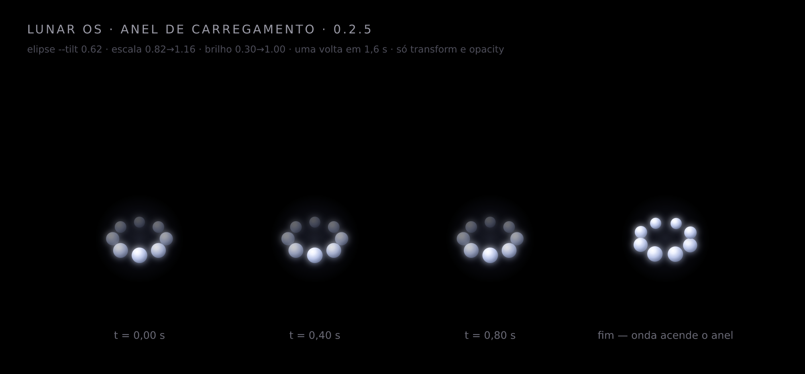

# Lunar OS

Web OS construído em fases. Esta entrega contém a **Fase 1: tela de boot e inicialização**.


> **Cache:** o servidor envia `Cache-Control: no-store`, o HTML referencia CSS/JS com `?v=0.2.5`
> e a página se auto-atualiza: ela compara a própria versão com `/version.json` (exposto pelo
> `server.mjs` a partir do `package.json`) e recarrega uma única vez se estiver velha.
> O rodapé mostra `demo 0.2.5` e o console imprime `Lunar OS · build 0.2.5`.

---

## Rodar

O projeto usa ES Modules, então precisa de um servidor HTTP (abrir `index.html` com `file://` não funciona).

```bash
npm start          # http://localhost:3000
# ou
PORT=8080 node server.mjs
```

Não há dependências: `server.mjs` é um servidor estático de ~70 linhas, escrito só com a biblioteca padrão do Node.

---

## Como a Fase 1 funciona

| Requisito | Implementação |
| --- | --- |
| Fundo preto absoluto | `background-color: #000` em `.boot` (sem gradiente, aura ou grão) |
| Apenas o ícone, centralizado, com fade-in | `.boot__logo` — fade de 1,6 s + micro-escala, orquestrado pela classe `.is-entered` |
| Bolinhas girando (padrão Windows) no lugar da barra | `.boot__dots` em `src/css/boot.css` (CSS puro, 8 pontos) |
| Som de boot em Web Audio API | `AudioEngine.playBootSequence()` em `src/js/core/audio.js` |
| Fade-out elegante para o desktop | `.boot.is-leaving` → `.boot.is-gone`, com `.desktop.is-visible` entrando junto |
| Fonte Plus Jakarta Sans | `src/css/fonts.css` (arquivos `.woff2` locais, SIL OFL) |

### As bolinhas girando

Implementadas em **CSS puro**, sem canvas e sem imagem. São 8 `<span>` com as mesmas
animações e um `animation-delay` diferente por ponto (`--spin ÷ 8 × --i`), de modo que num
mesmo instante cada ponto está numa fase distinta do ciclo — essa defasagem é o que cria o
rastro.

**Duas animações por ponto, ambas no compositor:**

| Animação | O que faz | Propriedade |
| --- | --- | --- |
| `dotPath` | percorre a elipse do anel, crescendo ao passar pela frente e encolhendo no fundo | `transform` |
| `dotLume` | brilho acompanhando a profundidade: aceso na frente, apagado atrás | `opacity` |



A elipse é aplicada dentro do próprio keyframe (`--tilt`, padrão `0.62`), nunca com
`rotateX` no elemento. Cada ponto recebe **escala uniforme** (0,82 no fundo → 1,16 na
frente) e **opacidade própria** (0,30 no fundo → 1,00 na frente), então o ponto continua
circular e o volume vem da luz, não de uma deformação.

Há ainda um halo ambiente bem discreto atrás do anel (`.boot__dots::before`): um gradiente
translúcido que respira em `opacity` — não toca no preto absoluto do fundo e não repinta.

#### Perspectiva: por que as bolinhas pareciam "chapadas no chão"

A primeira tentativa de 3D inclinou o plano do anel com `rotateX(58deg)`. O resultado foi
pior que o original: a rotação 3D achatava o **próprio ponto** — cada bolinha virava uma
elipse fina, como uma moeda vista de lado. Outra tentativa usou `scaleY(0.62)` em volta da
órbita inteira, o que encolhia também a espessura do ponto e deixava o anel sem leitura de
profundidade.

Hoje a perspectiva não vem de rotação: o ponto é posicionado direto na elipse
(`x = R·sen θ`, `y = −R·cos θ`, com o eixo Y multiplicado por `--tilt`) e recebe **escala e
opacidade próprias**. São 16 paradas no keyframe, porque com 4 a interpolação do
`translate` corta os cantos e o percurso vira um losango.

O visual de esfera vem do gradiente radial com realce fora do centro (`circle at 34% 26%`)
mais uma sombra interna na base — um gradiente centralizado lia como adesivo.

Todos os raios derivam de `--u` (a unidade de escala da tela): `--ring: calc(var(--u) *
0.42)`, `--dot: calc(var(--ring) * 0.2)`, `--orbit: calc((var(--ring) - var(--dot)) / 2)`.
O anel é sempre 42% do ícone e o ponto sempre 20% do anel, de 320 px a 2560 px de tela.

#### Cinco armadilhas que já quebraram esta animação

1. **Faixas de 12,5% em `steps`.** A primeira versão do rastro usava 8 patamares de
   opacidade seguidos de salto; medido quadro a quadro, o brilho ficava 6 amostras
   idêntico e então pulava. A correção é interpolar a curva.
2. **Rotação de 0° a 360°.** São o mesmo ponto: um keyframe com só `0%` e `100%` não gira.
   Passos intermediários forçam o avanço.
3. **Somar o ângulo duas vezes.** O deslocamento de cada ponto já vem do `animation-delay`;
   somar também `rotate(var(--i) * 45deg)` no keyframe fazia o ponto 4 cair sobre o 0 e o
   anel ficava com 4 posições.
4. **Sinal do `animation-delay`.** Com atraso negativo, a cauda aparece na frente do líder
   e o conjunto lê como uma cobra girando ao contrário do próprio movimento. O atraso é
   positivo: cada ponto entra depois do vizinho, e com o giro no sentido horário o ponto 0
   é o líder e os demais formam a cauda.
5. **`opacity` na regra vs. animação em `opacity`.** O fim do boot declarava
   `opacity: 0.95` na regra, mas a animação de brilho continuava valendo — e **animação
   vence regra**. O anel nunca acendia de verdade. A correção está na seção seguinte.

#### Custo por quadro

O desfoque de profundidade (`filter: blur()`) animado foi removido: como `filter` não é
composto, ele repinta os 8 elementos a cada quadro. Medição no navegador real, tela de
900×620: **22 fps com `filter`, 60 fps estáveis sem ele**. A profundidade hoje é feita só
por escala e opacidade, e os deslocamentos usam `translate3d` para garantir a promoção ao
compositor em navegadores móveis.

#### Encerramento

Ao completar, a órbita é congelada e o anel acende numa **onda**: cada ponto acende ~30 ms
depois do anterior, então a luz percorre o anel antes do fade-out (antes os oito tentavam
acender juntos e o efeito não acontecia). A onda é uma segunda animação, `dotSeal`, que
roda mesmo com a órbita pausada:

```css
animation: dotPath var(--spin) linear infinite, dotSeal 460ms var(--ease-out) forwards;
animation-play-state: paused, running; /* pausa a órbita, mantém a onda */
```

O atalho `animation` **zera** o `animation-delay`; sem redeclarar o delay nessa regra, os 8
pontos empilham no centro e viram um único blob. O fade-out também é escalonado por ponto,
para o anel dissolver de forma contínua em vez de sumir de uma vez.

Com `prefers-reduced-motion` ativo (o "Efeitos de animação" desligado no Windows) a regra
global de acessibilidade zera a duração de **todas** as animações — o anel ficaria estático
e uniforme, parecendo travado. As bolinhas reativam a própria animação com `!important`, em
ritmo 2× mais lento, mantendo o rastro.

### Escala universal (celular → monitor grande)

Nenhum breakpoint redimensiona o layout em saltos. Existe **uma** unidade, `--u`, e todo
o resto deriva dela:

```css
.boot {
  --u: clamp(88px, min(40vw, 44vh), 248px); /* menor dimensão manda */
  --logo: var(--u);
}
.boot__dots {
  --ring: calc(var(--u) * 0.42);            /* anel = 42% do ícone */
  --dot: calc(var(--ring) * 0.2);           /* ponto = 20% do anel */
  --orbit: calc((var(--ring) - var(--dot)) / 2);
}
```

| Regra | Por quê |
| --- | --- |
| `40vw` | celular em retrato: a largura é o limite real |
| `44vh` | notebook de tela baixa, janela achatada, tela dividida, celular deitado |
| `clamp(88px, …, 248px)` | piso de segurança e teto para monitores grandes |

Como logo, anel, ponto, texto e botões saem todos de `--u`, a **proporção é constante** em
qualquer tela e o conteúdo **não tem como não caber**: `--u` já é proporcional à menor
dimensão da janela, com folga para o rodapé.

O que mudou na 0.2.5: antes havia quatro faixas de media query (620 px de altura, 460 px de
altura, 480 px de largura, 1600 px de largura) e elas se **anulavam** em janelas como
1024×400 ou 717×442 — a faixa de altura e a de largura disputavam a mesma regra e o
resultado dependia da ordem no arquivo. Agora só existem duas exceções declarativas, e
ambas mexem apenas no tamanho, nunca na proporção: `max-height: 440px` (janelas muito
baixas ficam mais compactas) e `max-width: 520px` (controles centralizados, rótulo de build
oculto).

Complementos de adaptação:

- `padding` com `env(safe-area-inset-*)` — notch, Dynamic Island e barra de gestos;
- `100svh`/`dvh` não são necessários porque o `.boot` é `position: fixed; inset: 0`;
- o rodapé (build + Som/Pular) virou **flex no fluxo**, não `position: absolute`: em janelas
  baixas os botões ficavam por cima do texto de status. Agora nada sobrepõe nada;
- o cartão do desktop tem `max-height: 100%` com rolagem interna, então em 1024×400 ou
  717×442 os botões continuam alcançáveis;
- alvos de toque de 44 px (`.ui-button`) e 34 px (Som/Pular) em `(hover: none)` ou
  `(pointer: coarse)`;
- a altura do texto de status é **reservada** medindo a mensagem mais longa (ver
  `_reserveStatus`), então trocar "Iniciando" por "Toque na tela…" não desloca logo e anel.

### O boot não pode depender de nada que o navegador possa segurar

Duas causas independentes levaram ao mesmo sintoma: **tela preta em "Iniciando" até o
usuário clicar em *Pular***.

**1. `requestAnimationFrame`.** O boot inteiro (progresso, troca de mensagens, conclusão)
rodava dentro de um laço de rAF, e o próprio `main.js` iniciava a sequência dentro de um
rAF. Em abas em segundo plano, **iframes não visíveis** e com throttling, o rAF pode
simplesmente nunca disparar.

**2. O módulo que nunca chega.** Se `src/js/main.js` não carregar — navegador sem suporte a
`type="module"`, erro de sintaxe, import bloqueado por política de rede, extensão
interceptando, proxy/CDN devolvendo outra coisa — **nenhum código da aplicação roda** e a
tela fica preta para sempre. Nenhum watchdog dentro do módulo resolve isso, porque o
watchdog também estaria dentro do módulo. Era o caso "só destrava no Pular" mais difícil de
ver: o botão funciona (é HTML puro) e o resto não existe.

Hoje:

- `main.js` inicia **sincronamente** (nem `setTimeout(0)`, que é agrupado/adiado em abas
  ocultas);
- o progresso é dirigido por `setTimeout(90ms)` e `performance.now()`, então o tempo real
  manda;
- a espera por fontes/imagem usa apenas Promises e `setTimeout`;
- `visibilitychange` e `focus` realinham o progresso ao voltar;
- `start()` é chamado dentro de `try/catch` em `main.js`: um erro no controlador revela o
  desktop em vez de terminar em tela preta;
- um watchdog de **15 s** chama `skip()` se qualquer coisa travar.

**Fallback sem JavaScript de módulo.** O `index.html` tem um segundo caminho, escrito como
script **clássico** (avaliado antes do módulo, sem `import`):

| Momento | O que acontece |
| --- | --- |
| construtor do `BootSequence` | grava `<html data-boot-ready="1">` |
| `load` + **5 s** sem essa marca | `.boot-fallback` no `<html>`: boot sai, desktop entra |
| **10 s** de página (mesmo sem `load`) | o mesmo, como rede final |

Ou seja: se o módulo não vier, o usuário vê a área de trabalho em 5 s, sem precisar
descobrir o botão *Pular*.

A animação das bolinhas continua sendo CSS, que independe de rAF (e fica pausada quando a
aba está oculta, por economia).

### O boot travava em "Pronto" (áudio bloqueado)

O sintoma relatado foi "às vezes demora muito e só aparece Iniciando, sem os
textos de preparando". Reproduzido de forma determinística colocando a página
em segundo plano: o status chegava a **"Pronto"** e a tela **nunca** saía do
boot — nem depois de voltar ao foco.

Causa: sem gesto do usuário, o Chrome bloqueia o autoplay e
`AudioContext.resume()` **não rejeita** — a Promise simplesmente nunca resolve.
O `await this._playBootSound()` em `_complete()` ficava pendurado para sempre,
e a chamada a `_reveal()` que vem depois nunca acontecia. O console registrava
`The AudioContext was not allowed to start`.

Duas correções independentes:

1. `AudioEngine.unlock()` corre `ctx.resume()` contra um prazo de 700 ms, então
   nunca pode ficar pendurado.
2. `_complete()` protege a reprodução do som com um prazo **e** arma um
   temporizador de segurança que revela o desktop de qualquer forma. Nenhuma
   etapa — áudio, fonte ou imagem — consegue mais impedir a saída do boot.

O ritmo também foi encurtado: ~4,9 s no total (era ~6,5 s), e a espera por um
gesto para ouvir o som caiu de 4,2 s para 1,6 s.


### Responsividade — verificação

A composição é centralizada e sem sobreposição entre ícone, anel, texto e controles em
qualquer combinação de largura e altura, porque todos os tamanhos saem da mesma unidade
`--u` (ver *Escala universal*). O que a 0.2.5 corrigiu, além das faixas que se anulavam:

| Sintoma | Correção |
| --- | --- |
| Controles absolutos cobriam o status em janelas baixas | rodapé virou flex no fluxo |
| Texto longo ("Toque na tela…") empurrava logo e anel | altura do status reservada por medição |
| Cartão do desktop cortado em 1024×400 / 717×442 | `max-height: 100%` + rolagem interna |
| Logo colado na borda em telas com notch | `env(safe-area-inset-*)` |
| Botões pequenos no celular | 44 px (`ui-button`) e 34 px (Som/Pular) em toque |

Telas conferidas: 320×568, 360×640, 390×844, 414×896, 753×618, 1024×400, 1280×720,
1366×768, 1440×900, 1920×1080, 2560×1440, além de 844×390 e 667×375 (celular deitado).

### O som de boot

Sintetizado no momento do clique final, em quatro camadas:

| Camada | Detalhe |
| --- | --- |
| Pad ascendente | Tríade Dó maior (C3–G3–C4), triângulo, com glissando curto para cima |
| Arpejo | C4–E4–G4–D5 (Dó maior add9) em senoides, entrando a cada 105 ms |
| Sino | 1046 / 1567 / 2093 Hz com decaimento longo |
| Ar | Ruído gerado em buffer, filtro band-pass subindo de 700 Hz a 4,2 kHz |

Um low-pass compartilhado abre de 420 Hz a 5,2 kHz durante o acorde (o som "nasce abafado e termina luminoso") e um compressor segura os picos. Duração total ≈ 2,6 s; o fade-out do boot espera o som terminar.

### Áudio bloqueado (política de autoplay)

Navegadores não deixam tocar áudio antes de um gesto. O fluxo cobre os dois casos:

- **Com gesto** (clique/tecla em qualquer lugar): o áudio é destravado, o acorde toca e a tela revela o desktop.
- **Sem gesto**: o boot chega a 100% e mostra *"Toque na tela para ouvir o som de boot"* com o indicador de som pulsando. O primeiro gesto toca o acorde; se não houver gesto em ~1,6 s, a demo revela o desktop mesmo assim — e há ainda um temporizador de segurança que revela de qualquer forma caso qualquer etapa trave.

Há também o botão **Som** (canto inferior direito) para ligar/desligar, e **ESC** ou **Pular** para ir direto ao fim — nunca a um estado intermediário quebrado.

---

## Estrutura

```
index.html
server.mjs                 # servidor estático sem dependências
assets/
  lunar-boot.png           # logo 3D usada no boot
  lunar-logo.png           # logo base (usada na barra de tarefas, Fase 2)
fonts/                     # Plus Jakarta Sans 200–800 (woff2)
src/css/
  fonts.css  base.css  boot.css  desktop.css
src/js/
  main.js                  # ponto de entrada
  core/ease.js             # curvas e PRNG determinístico
  core/audio.js            # motor de áudio sintetizado
  boot/boot.js             # controlador da sequência de boot
```

`src/js/desktop/` já existe vazio, reservado para as Fases 2 e 3.

---

## Regras do projeto respeitadas

- **Apenas duas imagens reais** (`assets/lunar-boot.png`, `assets/lunar-logo.png`). Papel de parede e demais efeitos são gerados em runtime; as bolinhas do carregamento são CSS puro.
- **Nenhum arquivo de áudio.** Todo som vem de osciladores e buffers da Web Audio API.
- **Nenhuma persistência.** Não há `localStorage`, cookies, IndexedDB ou escrita em disco; todo estado vive em memória. A convenção de `tmp/` está documentada no `.gitignore` para as próximas fases.
- **Tipografia**: Plus Jakarta Sans, com fallback para a pilha do sistema.

---

## Próximas fases

- **Fase 2** — papel de parede dinâmico em Canvas, barra de tarefas com vidro fosco, botão Iniciar com `lunar-logo.png` e relógio em tempo real.
- **Fase 3** — motor de janelas (abrir, fechar, arrastar) e terminal com VFS em memória.

> O desktop atual exibe um cartão com *Repetir boot* e *Testar som do sistema* — andaimes de demonstração para validar a Fase 1; a Fase 2 os substitui pelo ambiente real.
