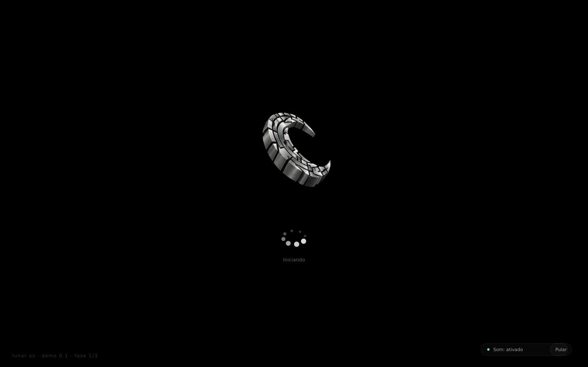

# Lunar OS

Web OS construído em fases. Esta entrega contém a **Fase 1: tela de boot e inicialização**.



---

## Rodar

O projeto usa ES Modules, então precisa de um servidor HTTP (abrir `index.html` com `file://` não funciona).

```bash
npm start          # http://localhost:3000
# ou
PORT=8080 node server.mjs
```

Não há dependências: `server.mjs` é um servidor estático de ~70 linhas, escrito só com a biblioteca padrão do Node.

---

## Como a Fase 1 funciona

| Requisito | Implementação |
| --- | --- |
| Fundo preto absoluto | `background-color: #000` em `.boot` (sem gradiente, aura ou grão) |
| Apenas o ícone, centralizado, com fade-in | `.boot__logo` — fade de 1,6 s + micro-escala, orquestrado pela classe `.is-entered` |
| Bolinhas girando (padrão Windows) no lugar da barra | `src/js/boot/spinner-dots.js` |
| Som de boot em Web Audio API | `AudioEngine.playBootSequence()` em `src/js/core/audio.js` |
| Fade-out elegante para o desktop | `.boot.is-leaving` → `.boot.is-gone`, com `.desktop.is-visible` entrando junto |
| Fonte Plus Jakarta Sans | `src/css/fonts.css` (arquivos `.woff2` locais, SIL OFL) |

### As bolinhas girando

Desenhadas proceduralmente na Canvas API — nenhum SVG, nenhum GIF:

1. **Anel inclinado**: 8 pontos distribuídos num círculo achatado (`tilt: 0.62`), o que dá a sensação de um globo girando em vez de um disco chapado.
2. **Cabeça e cauda**: o ponto que lidera é o maior e mais claro; os seguintes reduzem de tamanho e desbotam (`pow(head, 1.7)`), reproduzindo o rastro do carregamento do Windows.
3. **Profundidade**: pontos na metade da frente do ciclo ficam maiores e mais opacos — o giro parece ter perspectiva.
4. **Fechamento**: ao terminar, o anel desacelera, achata-se até virar círculo, acende e dissolve — em vez de simplesmente desaparecer.

Custo por frame: 8 chamadas de `arc`. Sem blur, sombra ou gradiente por ponto. O canvas é redimensionado por `devicePixelRatio` (limitado a 2) e o loop pausa quando a aba fica oculta.

O progresso interno (0 → 1) continua existindo, mas agora só alimenta a mensagem de status — *Iniciando*, *Carregando recursos*, *Preparando a área de trabalho*, *Quase lá*. Não há barra nem percentual na tela.

### O som de boot

Sintetizado no momento do clique final, em quatro camadas:

| Camada | Detalhe |
| --- | --- |
| Pad ascendente | Tríade Dó maior (C3–G3–C4), triângulo, com glissando curto para cima |
| Arpejo | C4–E4–G4–D5 (Dó maior add9) em senoides, entrando a cada 105 ms |
| Sino | 1046 / 1567 / 2093 Hz com decaimento longo |
| Ar | Ruído gerado em buffer, filtro band-pass subindo de 700 Hz a 4,2 kHz |

Um low-pass compartilhado abre de 420 Hz a 5,2 kHz durante o acorde (o som "nasce abafado e termina luminoso") e um compressor segura os picos. Duração total ≈ 2,6 s; o fade-out do boot espera o som terminar.

### Áudio bloqueado (política de autoplay)

Navegadores não deixam tocar áudio antes de um gesto. O fluxo cobre os dois casos:

- **Com gesto** (clique/tecla em qualquer lugar): o áudio é destravado, o acorde toca e a tela revela o desktop.
- **Sem gesto**: o boot chega a 100% e mostra *"Toque na tela para ouvir o som de boot"* com o indicador de som pulsando. O primeiro gesto toca o acorde; se não houver gesto em ~4 s, a demo revela o desktop mesmo assim (nunca trava).

Há também o botão **Som** (canto inferior direito) para ligar/desligar, e **ESC** ou **Pular** para ir direto ao fim — nunca a um estado intermediário quebrado.

---

## Estrutura

```
index.html
server.mjs                 # servidor estático sem dependências
assets/
  lunar-boot.png           # logo 3D usada no boot
  lunar-logo.png           # logo base (usada na barra de tarefas, Fase 2)
fonts/                     # Plus Jakarta Sans 200–800 (woff2)
src/css/
  fonts.css  base.css  boot.css  desktop.css
src/js/
  main.js                  # ponto de entrada
  core/ease.js             # curvas e PRNG determinístico
  core/audio.js            # motor de áudio sintetizado
  boot/spinner-dots.js     # bolinhas girando (canvas)
  boot/boot.js             # controlador da sequência de boot
```

`src/js/desktop/` já existe vazio, reservado para as Fases 2 e 3.

---

## Regras do projeto respeitadas

- **Apenas duas imagens reais** (`assets/lunar-boot.png`, `assets/lunar-logo.png`). Papel de parede, bolinhas do carregamento e todos os efeitos são gerados em runtime.
- **Nenhum arquivo de áudio.** Todo som vem de osciladores e buffers da Web Audio API.
- **Nenhuma persistência.** Não há `localStorage`, cookies, IndexedDB ou escrita em disco; todo estado vive em memória. A convenção de `tmp/` está documentada no `.gitignore` para as próximas fases.
- **Tipografia**: Plus Jakarta Sans, com fallback para a pilha do sistema.

---

## Próximas fases

- **Fase 2** — papel de parede dinâmico em Canvas, barra de tarefas com vidro fosco, botão Iniciar com `lunar-logo.png` e relógio em tempo real.
- **Fase 3** — motor de janelas (abrir, fechar, arrastar) e terminal com VFS em memória.

> O desktop atual exibe um cartão com *Repetir boot* e *Testar som do sistema* — andaimes de demonstração para validar a Fase 1; a Fase 2 os substitui pelo ambiente real.
